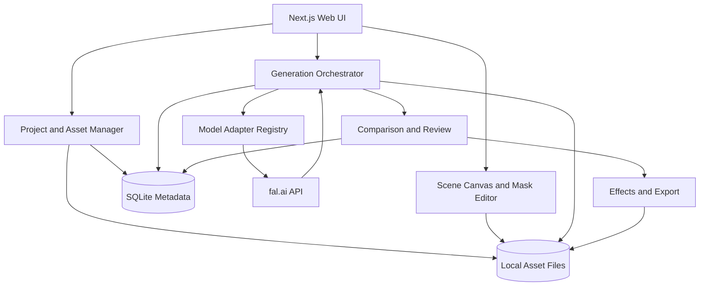
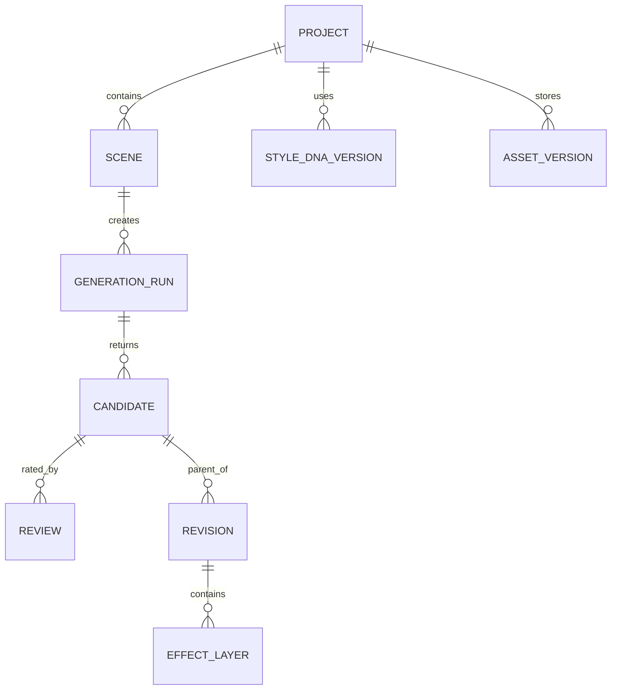

# AI Art Direction Studio — Prototype Development Plan

> Version: 1.0  
> Date: 2026-10-25  
> Status: Proposed / Ready for implementation  
> Goal: Validate an end-to-end, controllable AI illustration creation workflow using model APIs (primarily fal.ai).  
> Initial focus: Consistent anime-style characters, controllable composition, reusable visual style, targeted refinement, and effects.

---

## 1. Executive Summary

Build a **local-first web prototype** that converts a user's art direction into repeatable generation assets and an editable image history.

The workflow is:

1. **Style DNA** — derive and approve a reusable style specification and reference pack from prompts and images.
2. **Character / Object Asset Library** — create, approve, version, and reuse canonical reference sheets.
3. **Scene Layout** — sketch rough composition and specify positions, actions, camera, poses, and object relationships.
4. **Image Generation** — compile these sources into a model-specific request, generate alternatives, and record provenance.
5. **Validation & Refinement** — score the results against constraints, select winners, and revise portions or regenerate.
6. **Effects & Post-processing** — add effects and filters while preserving a non-destructive copy of the base image.

**Primary hypothesis:** A structured workflow that separates style, identity, and geometry yields more usable, consistent, and editable images than a single text prompt alone.

**This is a prototype for testing controllability, not a promise of pixel-perfect generation.** The application should expose control limitations and measure them.

## 2. Goals and Non-goals

### 2.1 Goals

- Complete one fully persisted end-to-end generation in the UI without changing source code.
- Reuse the same approved character and Style DNA across at least three substantially different compositions.
- Compare two or more model routes on identical creative inputs.
- Keep stable assets unchanged while making a targeted visual revision.
- Capture model inputs, outputs, durations, usage/cost estimates, revisions, and user ratings.
- Allow iterative experimentation without accidentally overwriting approved assets.
- Use a server-side fal.ai integration so API keys never reach the browser.

### 2.2 Non-goals for MVP

- Production-scale multi-user collaboration, payments, social features, or cloud deployment.
- Automatic LoRA training infrastructure, complex ControlNet scheduling, custom GPU hosting.
- Full animation/video generation, timeline editor, or frame-to-frame video consistency.
- A fully featured Photoshop/Blender replacement.
- Guaranteed identity, exact pixel placement, or unchanged surroundings during AI edits.
- Fully automatic evaluation of subjective visual quality.

### 2.3 Definition of success

A user can create a Style DNA and character reference, draw or upload a rough scene, generate 2–4 results, approve one, selectively refine it, apply at least one non-destructive effect, and reopen the project with its assets and complete lineage intact.

---

## 3. User Journey

**Demo scenario: anime-style swordsman**

1. Create project `Wind Duel` (16:9, 1280×720 target output when endpoint permits).
2. Upload 3–6 style examples and describe desired linework/shading/colors.
3. Receive a draft Style DNA. Generate a neutral style test grid; approve a version.
4. Upload/create character images (front / profile / back / close-up); designate canonical ones.
5. Open a scene, draw a rough fighter silhouette and sword direction, indicate left-to-right motion, and write camera/background notes.
6. Choose a model route, inspect exact inputs being sent, and request 2–4 candidate renders.
7. Evaluate identity, composition, style, and overall usefulness for each candidate.
8. Refine only the blade or face by making a mask and requesting an edit.
9. Add a blue wind-slash overlay and adjust its opacity/position; export image and project manifest.
10. Duplicate the scene and modify pose/camera without replacing Style DNA or canonical identity.

---

## 4. Application Information Architecture

### Main navigation

| Page | Role | MVP |
|---|---|---|
| Projects | Browse/create projects and scenes | Required |
| Style DNA | Import references, edit structured style, approve versions | Required |
| Asset Library | Character / object reference sheets and approved variants | Required |
| Scene Editor | Sketch/layout, prompts, object placements | Required |
| Generate | Select model, preview compiled request, run comparisons | Required |
| Review & Refine | Compare, score, fork, mask/edit | Required |
| Effects | Layer overlay and simple deterministic filters | Required |
| History / Experiments | View lineage, input snapshots, scores, estimated spend | Required |
| Training Lab | Dataset curation and LoRA training | Later |

### Primary UX layout

- **Left panel:** project, Style DNA, assets, scene selector.
- **Center canvas:** drawing/sketch, generated image, masks, overlay handles.
- **Right panel:** context-dependent properties and generation settings.
- **Bottom strip:** candidate thumbnails, revisions, lineage, ratings.
- **Persistent actions:** Save Draft, Generate, Compare, Approve, Fork, Export.

No blocking requirement for elaborate design; prioritize intelligible controls and visibility of what was sent to the model.

---

## 5. Functional Requirements by Stage

### Stage A — Style DNA

**Inputs**
- Free-text description.
- Multiple inspiration images (user-supplied or explicitly generated within the project).
- Optional negative instructions, e.g., `avoid painterly gradients`.

**Structured output (editable, not treated as immutable truth)**
- `linework`: thickness variation, edge treatment, line density.
- `shading`: hard cel shading / soft gradients / shadow steps.
- `palette`: dominant colors, saturation, contrast, shadows.
- `anatomy`: proportions, facial features, exaggeration level.
- `rendering`: texture, brush/grain, background detail level.
- `lighting`: lighting motifs and contrast.
- `effects_language`: speed lines, impact frames, glows, particles.
- `prompt_template`: positive/negative instructions for model adapters.
- `references`: source examples and reviewed style-only examples.

**Workflow**
1. Upload images and enter style directions.
2. Optionally ask a vision-capable model to propose a draft structured profile. If such API is not configured, allow manual entry; do not block MVP.
3. Generate a test set with different **subjects** (portrait, full body, prop, background). This reduces the chance of confusing repeated subject matter with actual style.
4. User selects representative samples and locks an approved Style DNA version.
5. Save both source images and approved test samples, with provenance.

**Important:** Style references can cause content leakage (copying the reference's subject/layout). Treat Style DNA as a collection of text and visual examples, **not a guaranteed style embedding**. LoRA training is optional later.

### Stage B — Character / Object Asset Library

**Required fields:** asset type, name, description, stable visual attributes, changeable attributes, images, canonical status, version, relationship to Style DNA.

**Reference slots**: front, 3/4, side, back, face close-up, expressions, equipment detail. Slots can be empty; they must never be invented automatically as factual references.

**Workflow**
1. Create asset from prompt + optional source images.
2. Generate reference variants using an image-edit/generation route.
3. Inspect for conflicts: eye color, outfit details, weapon dimensions, accessories.
4. Approve specific images as canonical; record decisions in a text description.
5. Use only approved versions in production scene prompts by default.

**Character vs style:** Character ID must not implicitly bind to exactly one style; the app should allow a character to render under another Style DNA for experiments.

### Stage C — Scene Layout / Composition

**MVP inputs**
- Sketch on canvas with freehand pen/eraser and an image upload option.
- Basic labeled rectangles / regions for character, object, background, effect.
- Optional per-object properties: approximate normalized box `(x,y,w,h)` in 0–1, facing direction, importance, occlusion order.
- Camera description: shot type, angle, lens intent (descriptive only), perspective.
- Scene prompt, motion/action description, environment.
- Canvas aspect ratio and target dimensions.

**MVP outputs**
- Sketch PNG, annotated layout JSON, structured scene description, composited guide image for APIs where useful.

**Deliberately not in MVP:** skeleton joint editor, depth generation, Blender embedding. They may be added later as additional geometry controls.

**Caveat:** Passing a composition image does not guarantee exact pose/bounds. Different endpoints may treat it as inspiration rather than a hard geometric constraint; label these routes accordingly.

### Stage D — Image Generation

**Model routes**
- `reference_edit`: multimodal image edit/generation with multiple reference images.
- `structure_control`: ControlNet/pose/depth/edge route when supported.
- `text_baseline`: plain prompt without references as comparison.

**Model adapter contract**
- `id`, `provider`, `endpoint`, `features`, `constraints`, `pricingMetadata`.
- `validate(scene, references)`: explicit compatibility warnings.
- `compile(context)`: prompt, reference order, settings, optional control images.
- `submit(request)`, `poll(requestId)`, `normalize(result)`.

**MVP target:** configure one verified API endpoint and at least one comparator; use only capabilities actually supported by the selected endpoint's published schema.

**Initial candidates verified against fal.ai official pages on 2026-10-25**
- `fal-ai/flux-2/edit`: multi-image editing; public API docs show up to **4** image URLs on this specific endpoint, so the adapter must enforce that limit.
- `fal-ai/flux-general`: FLUX.1 dev endpoint with ControlNet, LoRA, IP-Adapter and reference-only guidance; useful later for controlled experiments.

Different similarly named FLUX endpoints can support different input counts and features. Do not generalize across model names; fetch the endpoint schema during implementation.

**Candidate comparison**
- One request snapshot per candidate group: same task, references, aspect ratio, and prompt intent.
- Persist each model's translated request separately because model-native arguments differ.
- Generate multiple outputs per route and compare them in a grid.
- Use asynchronous queue/polling for slow inference; show queued/running/done/error states.
- Download/copy API output to project storage promptly instead of relying on long-term retention of provider URLs.

### Stage E — Validation / Refinement

**Human ratings (1–5 each)**
- Identity fidelity: hair, face, clothing, weapon/prop consistency.
- Composition adherence: subject placement, size, camera, posture.
- Style adherence: linework, shading, palette, overall look.
- Anatomy and image correctness: hands, objects, interaction, visual artifacts.
- Edit preservation (edits only): non-target areas left alone.

**Refine workflows**
- Select a candidate; annotate desired changes.
- Draw mask for target area, or use full-image natural-language edit if a model lacks mask support.
- Choose what must be preserved (identity, background, layout, color style).
- Create a **child revision**, never mutate parent output.
- Before submitting, warn if the selected model cannot guarantee local editing.

**Automatic evaluation, later:** image similarity, VLM checklist, bounding-box adherence, face/clothes consistency; treat scores as advisory and log evaluator version.

### Stage F — Effects & Post-processing

**MVP**: non-destructive effects canvas over base image.
- Import transparent PNG overlays (wind slash, sparks, dust) or reuse saved overlay assets.
- Move/scale/rotate opacity and layer order.
- Simple browser-based adjustments: brightness, contrast, saturation, blur.
- Save layer state to JSON; export composited PNG.

**Later**: generative effect sprites, background/foreground/person segmentation, masked relighting, glow, screen-space motion blur, temporal effects for video.

**Important distinction:** effects that modify subject illumination or hair/clothing may require integrated AI relighting/editing; a standalone transparent overlay may look unnatural. Keep both options without conflating them.

---

## 6. MVP Technical Architecture



### Recommended stack

| Layer | Choice | Why |
|---|---|---|
| UI | Next.js + React + TypeScript | Integrated frontend/server route for a small prototype |
| Styling | Tailwind CSS | Fast prototyping |
| Canvas | Konva / react-konva | Sketches, masks, draggable boxes and layers |
| Persistence | SQLite + Prisma (or Drizzle) | Local-first, versioned metadata |
| Binary assets | Local filesystem under app data dir | Simplifies early testing; store stable file IDs in DB |
| Generation API | fal.ai via `@fal-ai/client` | Queue support and broad model catalog |
| Background job | Server queue/polling with DB status | Track requests without relying on long HTTP connections |
| Validation | Zod schema validation | Protect model-adapter boundaries |
| Testing | Vitest + Playwright | Unit, integration, end-to-end UI tests |

### Security and reliability

- Keep `FAL_KEY` strictly in server environment variables; never in client JavaScript or database exports.
- Validate MIME/file size/image dimensions before processing uploads.
- Cap concurrent jobs, number of variations, output dimensions, and estimated experiment spend.
- Show rough cost estimate before run where pricing can be computed; label unknown prices `unavailable` rather than guessing.
- Never automatically retry a failed or timed-out paid request without checking provider request status first.
- Persist provider request ID as soon as available; implement resume/poll on reload.
- Retain consent/license/source metadata for uploaded references, particularly characters from third-party IP.
- Protect against malformed model outputs and stale URLs.
- Use a configurable app data directory; do not commit keys or binary outputs to Git.

---

## 7. Data Model



### Key entities

| Entity | Essential properties |
|---|---|
| `Project` | id, title, createdAt, currentSceneId |
| `StyleDNAVersion` | id, projectId, version, specification JSON, reference IDs, approvedAt |
| `AssetVersion` | id, projectId, logicalAssetId, kind, version, invariant JSON, variants, canonical image IDs, approvedAt |
| `Scene` | id, projectId, prompt, camera, layout JSON, sketch file ID, selected style/asset versions |
| `MediaFile` | id, sha256, mime, dimensions, localPath, source, licenseNotes |
| `GenerationRun` | id, sceneId, adapterId, actualEndpoint, compiled request snapshot, requestId, status, timestamps, priceEstimate/actualCost if available |
| `Candidate` | id, generationRunId, mediaFileId, parentCandidateId, seed if supported |
| `Review` | candidateId, ratings JSON, notes, approved flag |
| `Revision` | id, parentCandidateId, resultingCandidateId, maskId, instruction, preservation constraints |
| `EffectLayer` | id, revision/candidateId, imageFileId, x, y, scale, rotation, opacity, blend, zIndex |

**Provenance rule:** Every generated image records the *exact* Style DNA version, asset versions, scene snapshot, model endpoint, request parameters, and parent image. Asset updates must not retroactively change past generations.

### Example model-independent generation context

```json
{
  "styleDnaVersionId": "style-v3",
  "assetVersionIds": ["swordsman-v2", "katana-v1"],
  "sceneId": "scene-004",
  "scene": {
    "prompt": "A wind swordsman dashes from left to right",
    "camera": "extreme low-angle wide shot",
    "composition": {
      "subjectBox": [0.08, 0.23, 0.52, 0.67],
      "motionDirection": "left_to_right"
    },
    "sketchMediaId": "media-sketch-004"
  },
  "generation": {
    "modelAdapter": "flux2-edit",
    "size": [1280, 720],
    "variations": 3
  }
}
```

This JSON is an **application contract**, not a direct fal.ai request. The model adapter is responsible for translating it, reporting unsupported fields, ordering reference inputs and sending only valid API arguments.

---

## 8. API and Module Design

### Internal API routes

```text
POST   /api/projects
GET    /api/projects/:id
POST   /api/media/upload
POST   /api/styles
POST   /api/styles/:id/approve
POST   /api/assets
POST   /api/assets/:id/approve
POST   /api/scenes
PATCH  /api/scenes/:id
GET    /api/models
POST   /api/generations/preview
POST   /api/generations
GET    /api/generations/:id
POST   /api/candidates/:id/review
POST   /api/candidates/:id/refine
POST   /api/exports
```

### Preview-before-run contract

`POST /api/generations/preview` returns:
- Chosen endpoint and whether it supports image inputs, masks, LoRA, structure controls.
- Exact assets and image order that will be sent.
- Compiled prompt and public parameters.
- Compatibility warnings and omitted constraints.
- Estimated output dimensions and cost where verifiable.

Do not silently discard a reference image or control. E.g. if only four images are allowed, ask the user to select references or apply a documented selection strategy with a visible warning.

### Suggested repository structure

```text
ai-art-direction-studio/
├── app/
│   ├── projects/
│   ├── styles/
│   ├── assets/
│   ├── scenes/
│   ├── generate/
│   ├── review/
│   └── api/
├── components/
│   ├── canvas/
│   ├── editor/
│   ├── generation/
│   └── library/
├── lib/
│   ├── models/             # adapter contract + fal implementations
│   ├── planning/           # context compilation and prompt templates
│   ├── persistence/
│   ├── media/
│   └── evaluation/
├── prisma/
├── tests/
├── docs/
│   ├── ADR.md
│   ├── experiments.md
│   └── model-support-matrix.md
├── data/                   # ignored by git
├── .env.example
└── README.md
```

---

## 9. Model Selection and Experimental Method

### Route A: Reference-first

Use a multi-image editing model with Style DNA visual samples, character sheet(s), rough layout, and instruction. Some models will not reliably separate these roles; output is judged empirically.

### Route B: Geometry-first

Use a structure-conditioning model (e.g. FLUX General with compatible ControlNet setup) where supported, combining style and identity controls when compatible. This may require preprocessing sketches into edge/pose/depth maps and is a Phase 2 experiment.

### Route C: Prompt baseline

Use the same scene prompt **without** rich references. This establishes whether complexity actually improves output quality.

### Controlled comparison

1. Fix scene, intended character/style, aspect ratio, and task constraints.
2. Use 3–5 generations per route per scene, where budget permits.
3. Record model endpoint, seed if available, parameters, actual reference order.
4. Rate blind candidate outputs when practical to reduce model-name bias.
5. Compare mean/median user scores, pass rate, latency, and cost per approved result.
6. Separate intrinsic model strengths from unsupported controls, rather than assigning unsupported routes a misleading capability score.

### Test suite

| ID | Test | Measure |
|---|---|---|
| E01 | Same character, 5 poses | identity fidelity and outfit detail |
| E02 | Same character, 3 camera angles | camera + identity |
| E03 | Same style, portrait/prop/background | style transfer without copying subjects |
| E04 | Same rough layout, 3 model routes | placement and pose |
| E05 | Inpaint weapon, preserve face/background | edit preservation |
| E06 | Overlay slash effect, change opacity/order | controllable compositing |
| E07 | Reopen project / resume incomplete requests | provenance and reliability |
| E08 | Duplicate scene with updated pose only | reuse of locked assets |

**Primary product metric:** cost and number of generations to obtain **one user-approved image** that passes identity, style, and composition thresholds. Raw beauty alone is not enough.

### Provisional evaluation rubric

Score each category 1–5. Suggested initial pass: identity >=4, style >=4, composition >=4, anatomy >=3, with final user approval. Adjust thresholds after a real pilot.

---

## 10. Implementation Phases and Acceptance Criteria

### Phase 0 — Foundation and API Spike

**Deliver:** Next.js shell, local storage, project CRUD, upload, fal.ai server adapter, generation output saved locally, error handling, basic history.

**Acceptance:** User uploads a reference, submits a prompt, gets a persisted result, and reloads it without exposing API keys.

### Phase 1 — End-to-End MVP

**Deliver:** Manual Style DNA form/reference pack, character/object library with approvals, sketch canvas, scene editor, reference-first generation, candidate comparison, ratings, simple mask/refine action, overlay effects, PNG export.

**Acceptance:** Complete the demo scenario from §3 end to end with at least one model route and full lineage.

### Phase 2 — Model Comparison and Composition Control

**Deliver:** Second adapter, preview-before-run, consistent experiment templates, model comparison, request/cost logging; optional ControlNet route and pose/depth preprocessing.

**Acceptance:** Run E01–E08 and generate a comparison report of quality, time, and cost.

### Phase 3 — Optional Learned Identity/Style

**Deliver:** Curated training dataset export, compatible LoRA trainer integration, versioned LoRA registry, evaluation against no-LoRA baseline.

**Acceptance:** Demonstrate measurable improvement on held-out poses and scenes; avoid enabling LoRA globally if it harms flexibility.

### Phase 4 — Animation-oriented Extensions (Out of MVP)

**Explore:** keyframe sequences, shared camera geometry, action continuity, effect sprite sequences, optional video-to-video refinement. Do not couple first image prototype to this scope.

---

## 11. Task Backlog for Agentic Implementation

| ID | Task | Priority | Dependency | Done when |
|---|---|---|---|---|
| T01 | Scaffold Next.js/TypeScript project | P0 | — | App starts locally |
| T02 | SQLite schema and migrations | P0 | T01 | Project/assets/history persist |
| T03 | File upload/storage service | P0 | T02 | Reload images by stable IDs |
| T04 | fal API adapter with secret isolation | P0 | T01 | Generate + poll + save |
| T05 | Generation run lifecycle/history | P0 | T02,T04 | Retry/resume safely tracked |
| T06 | Style DNA editor/version approvals | P0 | T02,T03 | Reusable approved profile |
| T07 | Character/object library editor | P0 | T02,T03 | Canonical reference sheets |
| T08 | Sketch/layout scene editor | P0 | T03 | Save/reload sketch and layout |
| T09 | Context compiler and preview | P0 | T04,T06,T07,T08 | Model request inspectable |
| T10 | Generate + candidate gallery | P0 | T05,T09 | Compare and approve outputs |
| T11 | Review scores and result lineage | P0 | T10 | Keep ratings, parent links |
| T12 | Mask-based or full-image edit flow | P1 | T10 | Child revision saved |
| T13 | Effect overlay/editor/export | P1 | T10 | Non-destructive image export |
| T14 | Second adapter and model comparison | P1 | T09 | A/B model test works |
| T15 | Cost controls, usage records | P1 | T05 | Warnings and totals visible |
| T16 | Experimental templates E01–E08 | P1 | T14 | Comparable score report |
| T17 | ControlNet pose/depth integration | P2 | T14 | E04 geometry route |
| T18 | LoRA training interface | P3 | T16 | Measured against baseline |

### Suggested agent workflow

- **Planner agent:** Write/maintain issue scope, contracts, acceptance tests and architecture decisions. Avoid sprawling duplicate docs.
- **Implementation agent:** Implement one bounded issue at a time and run tests.
- **Review agent:** Inspect changes for API/schema mismatches, regressions, secret leakage and reproducibility; verify against acceptance criteria.
- **Human:** Approve creative references and images, select preferred model routes, resolve subjective style decisions.

Each issue should link to concrete files, expected UI behavior, error conditions, and exact commands for verification.

---

## 12. Risks and Mitigations

| Risk | Mitigation |
|---|---|
| References alter content instead of only style | Multiple test subjects, explicit reference roles, user approval |
| Character consistency decays over poses | Canonical sheet, explicit immutable traits, optional LoRA experiment |
| Rough sketch is treated as inspiration | Warning labels, geometry-specific route, eventual ControlNet |
| Image edits change unrelated areas | Preserve original, masks, compare overlays, child revisions |
| One model cannot combine all controls | Model capability registry + explicit omitted-input warnings |
| Incompatible LoRA/checkpoints | Record base model/version and validate supported inference endpoint |
| API features/prices change | Keep adapter-specific schema and pricing metadata maintainable |
| Cost spirals during iteration | Run caps, image size defaults, preview, cost-per-approved-result metric |
| Provider URLs expire | Save local copies and checksums |
| Background job lost on refresh | Persist queue IDs and statuses; resume polling |
| Copyright/license uncertainty | Reference provenance and explicit rights metadata |
| Overengineering before testing | P0 scope frozen; later features behind milestone gates |

---

## 13. Prototype Budget and Operating Constraints

No fixed pricing assumptions in business logic. Query or manually maintain verified endpoint pricing metadata, show its retrieval date, and compute actuals from provider billing data where available.

**Recommended initial policy** (configurable):
- Default 1 output per API run; explicit opt-in for 2–4 variants.
- Limit to 1 active expensive generation task until monitoring is stable.
- Default moderate output resolution and scale only approved images.
- Show budget warning before each model batch.
- Keep all failed-request IDs and avoid blind retries.
- Track total spent and **cost per approved image**.

**No initial cloud infrastructure required** beyond fal.ai. The app runs locally, but generation calls need an internet connection and paid API access where applicable.

---

## 14. Verification / Quality Checklist

### Functional

- [ ] Create project, style, asset and scene.
- [ ] Upload reference images, store source info and reload.
- [ ] Lock a specific approved Style DNA version.
- [ ] Lock canonical character/object versions.
- [ ] Draw and persist scene sketch and object boxes.
- [ ] Preview compiled model input including reference order.
- [ ] Generate through server-side API and poll safely.
- [ ] Compare candidates and save user ratings.
- [ ] Refine a selected candidate into a new revision.
- [ ] Add overlay effect and export flattened PNG.
- [ ] Reload project with the full lineage intact.

### Engineering

- [ ] API key never reaches browser, logs, or version control.
- [ ] Endpoint-specific input limits are validated.
- [ ] Input validation and upload size limits are implemented.
- [ ] Missing prices/control features are displayed honestly.
- [ ] Queue job state is persisted across refreshes.
- [ ] Failed/stale requests do not silently trigger duplicate paid calls.
- [ ] No history or canonical asset is overwritten by revision.
- [ ] Unit/API-mock/E2E smoke tests pass.

### Research

- [ ] Text-only baseline exists.
- [ ] Model comparison includes identical task intent and records actual arguments.
- [ ] Identity/style/composition rated independently.
- [ ] Report includes median cost, accepted rate and number of attempts per approved image.
- [ ] Document which failures are due to model limitations, app design or ambiguous references.

---

## 15. Decisions to Defer Until After Initial Tests

1. Whether a general-purpose multimodal editor is sufficient for style/identity without LoRA.
2. Whether exact geometric control justifies separate ControlNet/pose/depth passes.
3. Whether standalone effect overlays are enough for action anime or generative relighting is needed.
4. Whether model-specific native features warrant several adapters versus one primary route.
5. Whether the next investment should be in better references, a visual editor, or fine-tuning.

**Decision gate:** Do not implement LoRA training or advanced 3D controls before running the simple baseline and documenting the concrete failure modes.

---

## 16. Reference Documentation (Verified 2026-10-25)

- fal.ai FLUX.2 Edit API: https://fal.ai/models/fal-ai/flux-2/edit/api
- fal.ai FLUX.2 Edit overview: https://fal.ai/models/fal-ai/flux-2/edit
- fal.ai FLUX General (ControlNet, IP-Adapter, LoRA): https://fal.ai/models/fal-ai/flux-general
- fal.ai JavaScript client: https://docs.fal.ai/client-libraries/javascript

**Verification note:** Model catalogs, compatibility, prices, and endpoint schemas evolve. Confirm the exact API schema and costs during implementation rather than relying on generalized model family descriptions.

---

## 17. Recommended First Build Slice

**Build a vertical slice before the full interface:**

1. Upload **one character reference**, **one style reference**, and **one sketch**.
2. Edit scene prompt and preview how those images are mapped to the selected model.
3. Submit one generation through a supported reference-edit endpoint.
4. Persist request, image, time, and settings locally.
5. Compare output against requirements and rate it.
6. Make one revision, retaining the original.
7. Export image and reproducible project manifest.

Once this works, replace each hardcoded reference with the full Style DNA, Asset Library, and Scene Editor modules. This reduces risk while proving the full end-to-end interaction as early as possible.
